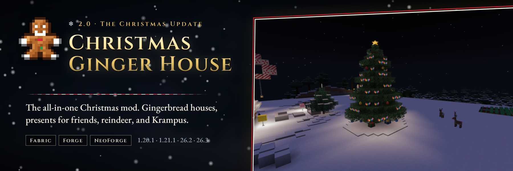

# Christmas Ginger House



The all-in-one Christmas mod. Gingerbread houses and decorated Christmas trees generate in the snow.
Wrap presents for friends, open an advent calendar door each day, raise reindeer (one in fifty has a
glowing red nose), chase gingerbread men, bake and ice cookies, and decorate with lights, wreaths,
stockings and ornaments. Krampus walks the snow at night.

## Features (2.0)

- **Structures:** the gingerbread house and a decorated Christmas tree, both with sealed presents.
- **Presents:** wrap up to 9 items, the sender's name goes on the tag, break to carry, unwrap with confetti.
- **Advent calendar:** one door per Minecraft day per player, 24 doors, gold present on the last.
- **Creatures:** Gingerbread Man, Reindeer (red-nosed variant), Krampus.
- **Blocks:** gingerbread block, bricks, stairs, slab, wall, frosted bricks, door, trapdoor, icing, candy cane, peppermint.
- **Decorations:** Christmas lights, wreath, stocking, star topper, three ornaments.
- **Food and farming:** ginger crop and wild ginger, dough, gingerbread, icing, cookies, candy canes, hot cocoa.
- **Gear:** Santa hat (3D model), festive sweater, candy cane sword, sleigh bells, Jingle Bells music disc.
- 11 advancements, original sounds, data-driven spawns (biome tags) and loot.

See [`marketing/curseforge/description.md`](marketing/curseforge/description.md) for the full listing.

## Supported versions

These are the only supported targets (the NightBeam convention): 8 jars per release, all with the same version
and the same 2.0 content.

| Minecraft | Loaders | Java | Folder |
| --- | --- | --- | --- |
| 1.20.1 | Forge, Fabric | 17 bytecode (build on 21) | `1.20.1/{common,forge,fabric}` |
| 1.21.1 | NeoForge, Fabric | 21 | `1.21.1/{common,neoforge,fabric}` |
| 26.2 | NeoForge, Fabric | 25 | `26.2/{common,neoforge,fabric}` |
| 26.3 | NeoForge, Fabric | 25 | `26.3/{common,neoforge,fabric}` |

Every root is an independent Gradle build with the same features, mod id and registry names. Fabric needs
Fabric API on every version.

## Assets

Every texture, model, blockstate, loot table, recipe, tag, advancement, sound and structure in
every root is generated by one script, so the art can be tweaked and rebuilt everywhere at once.
`tools/assets/targets.py` translates the data for each Minecraft version (folder names, item
components, recipe and predicate formats, 26.x item definitions and equipment assets, the 26.3 data format):

```bash
python3 tools/assets/build_all.py                   # every root; needs Pillow, numpy, nbtlib and ffmpeg (libvorbis)
python3 tools/assets/build_all.py --target 26.3     # one root
python3 tools/assets/build_all.py --no-sound        # skip audio synthesis
```

Listing artwork lives in [`marketing/`](marketing/README.md).

## Building

Each Minecraft version is a separate MultiLoader Gradle workspace with its own wrapper (see the table above). The
root build drives all four:

```bash
./gradlew buildAll             # every workspace, then the 8 loader jars into releases/
./gradlew build262             # one workspace (also build1201, build1211, build263)
cd 1.20.1 && ./gradlew build   # Gradle 8.11 on Java 21 (Java 17 toolchain)
cd 1.21.1 && ./gradlew build   # Gradle 8.10 on Java 21
cd 26.3 && ./gradlew build     # Java 25 (the same for 26.2)
```

The root build hands the 26.x workspaces `JAVA_HOME_25_X64` or `JAVA_HOME_25` (or `-Pjava25Home=<jdk>`) and the
others `JAVA_HOME_21_X64` or `JAVA_HOME_21` (or `-Pjava21Home=<jdk>`); without them each workspace uses the current
`JAVA_HOME`. The 1.20.1 and 1.21.1 workspaces use Gradle 8.x, which cannot run on Java 25, so give them Java 21.
On Windows, run `.\gradlew.bat` instead of `./gradlew`.

Jars land in `<workspace>/<loader>/build/libs/christmas_ginger_house-<loader>-<minecraft>-<version>.jar`. Every
workspace's `gradle.properties` carries the same `version=`, and the root `VERSION` file matches it
(`./gradlew checkVersions`; set both with `./gradlew syncVersion -PmodVersion=x.y.z`).
`python3 scripts/check_targets.py workspaces` checks the targets, the shared version and the metadata ranges.

Run the game with `:fabric:runClient`, `:neoforge:runClient` or `:forge:runClient` inside a workspace. On 26.2 and
26.3, `build` also runs a Fabric server game test that spawns every mob next to a player and runs their AI.

## Releasing

CI (`.github/workflows/ci.yml`) builds all 8 jars on every push to `main` that touches the build. Publishing to
Modrinth and CurseForge is `.github/workflows/publish.yml`, run by hand (`version`, `dry_run`) or by a `v*.*.*` tag;
it never runs on a plain push. It refuses a second release of the mod on the same day (Africa/Tunis), takes the jars
from `releases/`, the GitHub Release or a build from source, and fails unless exactly the 8 jars are found. The
upload goes through `scripts/upload_platforms.mjs` (Fabric API required on Fabric; files already on either site are
skipped). It needs the secrets `MODRINTH_TOKEN`, `CURSEFORGE_TOKEN`, `CURSEFORGE_API_KEY` and the variables
`MODRINTH_ID`, `CURSEFORGE_ID` (the workflow falls back to this project's IDs if the variables are unset).

- Modrinth: `Ddgd2w2n` ([gingerbread-houses](https://modrinth.com/mod/Ddgd2w2n))
- CurseForge: `1409805`

1. Bump the version with `./gradlew syncVersion -PmodVersion=X.Y.Z` (writes `VERSION` and every workspace).
2. Add `patchnotes/Christmas-Ginger-House-X.Y.Z-PatchNotes.md` (the release notes) and a `## X.Y.Z` section at
   the top of `CHANGELOG.md`.
3. Prove it with a dry run (`gh workflow run publish.yml -f version=X.Y.Z -f dry_run=true`), then push a tag
   `vX.Y.Z` or run the **Publish** workflow by hand.

The `update_listing` option on manual runs also refreshes the Modrinth project page from `marketing/modrinth/`
(made by `python3 tools/make_modrinth_md.py .`) and `marketing/images/icon.png`. CurseForge has no API for the
project description or logo, so paste `marketing/curseforge/description.md` there by hand.

## Contributing

See [CONTRIBUTING.md](CONTRIBUTING.md).

## Security

See [.github/SECURITY.md](.github/SECURITY.md).

## License

Apache License 2.0. See [LICENSE](LICENSE) and [NOTICE](NOTICE).
