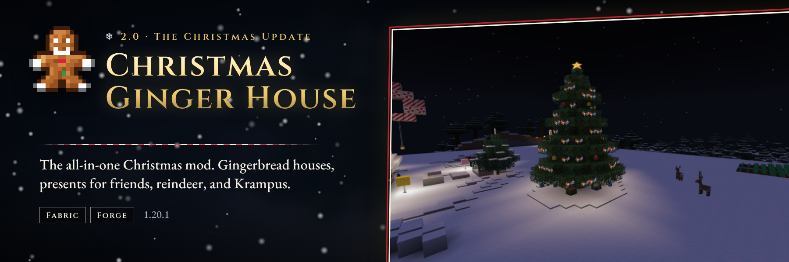

# Christmas Ginger House



The all-in-one Christmas mod. Gingerbread houses and decorated Christmas trees generate in the snow.
Wrap presents for friends, open an advent calendar door each day, raise reindeer (one in fifty has a
glowing red nose), chase gingerbread men, bake and ice cookies, and decorate with lights, wreaths,
stockings and ornaments. Krampus walks the snow at night.

## Features (2.0, Minecraft 1.20.1)

- **Structures:** the gingerbread house and a decorated Christmas tree, both with sealed presents.
- **Presents:** wrap up to 9 items, the sender's name goes on the tag, break to carry, unwrap with confetti.
- **Advent calendar:** one door per Minecraft day per player, 24 doors, gold present on the last.
- **Creatures:** Gingerbread Man, Reindeer (red-nosed variant), Krampus.
- **Blocks:** gingerbread block, bricks, stairs, slab, wall, frosted bricks, door, trapdoor, icing, candy cane, peppermint.
- **Decorations:** Christmas lights, wreath, stocking, star topper, three ornaments.
- **Food and farming:** ginger crop and wild ginger, dough, gingerbread, icing, cookies, candy canes, hot cocoa.
- **Gear:** Santa hat (3D model), festive sweater, candy cane sword, sleigh bells, Jingle Bells music disc.
- 11 advancements, original sounds, data-driven spawns (biome tags) and loot.

See [`marketing/curseforge/description.md`](marketing/curseforge/description.md) for the full listing.

## Version matrix

| Root | Minecraft | Loaders | Content |
| --- | --- | --- | --- |
| `1.20.1/` | 1.20.1 | Fabric, Forge | 2.0 full Christmas mod |
| `1.21.1/` | 1.21.1 | Fabric, NeoForge | 1.1 gingerbread house structure |
| `26.1.2/` | 26.1.2 | Fabric, NeoForge | 1.1 gingerbread house structure |
| `26.2/` | 26.2 | Fabric, NeoForge | 1.1 gingerbread house structure |

## Assets

Every texture, model, blockstate, loot table, recipe, tag, advancement, sound and structure in
`1.20.1/` is generated by a script, so the art can be tweaked and rebuilt:

```bash
python3 tools/assets/build_all.py            # needs Pillow, numpy, nbtlib and ffmpeg (with libvorbis)
python3 tools/assets/build_all.py --no-sound # skip audio synthesis
```

Listing artwork lives in [`marketing/`](marketing/README.md).

## Build

```bash
cd 26.2   # or 26.1.2 / 1.21.1 / 1.20.1
./gradlew build
```

JDK 25 is required for 26.x roots. JDK 21 for 1.21.1. JDK 17 for 1.20.1 (Gradle can provision it).

## Publish IDs

- Modrinth: `Ddgd2w2n` ([the-gingerbread-house](https://modrinth.com/mod/the-gingerbread-house))
- CurseForge: `1409805`

Local upload (26.1.2 and 26.2):

```bash
node scripts/upload_platforms.mjs --workspace 26.1.2 --version 1.1.0
node scripts/upload_platforms.mjs --workspace 26.2 --version 1.1.0
```

## Contributing

See [CONTRIBUTING.md](CONTRIBUTING.md).

## Security

See [.github/SECURITY.md](.github/SECURITY.md).

## License

Apache License 2.0. See [LICENSE](LICENSE) and [NOTICE](NOTICE).
