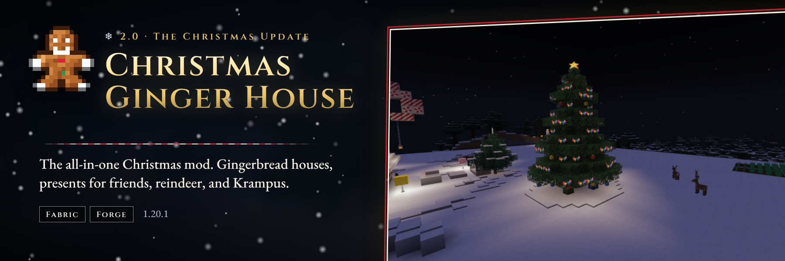

**[Discord](https://discord.gg/TJc3CxR4jK) · [Source and issues](https://github.com/MeherBenSalem/christmas-ginger-house)**

## The all-in-one Christmas mod

Gingerbread houses and decorated Christmas trees generate in the snow. Wrap presents for your friends, open one advent door a day, raise a herd of reindeer (one of them might have a glowing red nose), chase gingerbread men, bake and ice your own cookies, and deck your base with lights, wreaths, stockings and ornaments. Just keep an eye out for Krampus after dark.

**2.0 "The Christmas Update"** turns the original gingerbread house into a complete holiday mod: 40 items, 3 creatures, 2 structures, original textures, models and sounds, for **Minecraft 1.20.1, 1.21.1, 26.1.2 and 26.2** on Fabric, Forge and NeoForge.

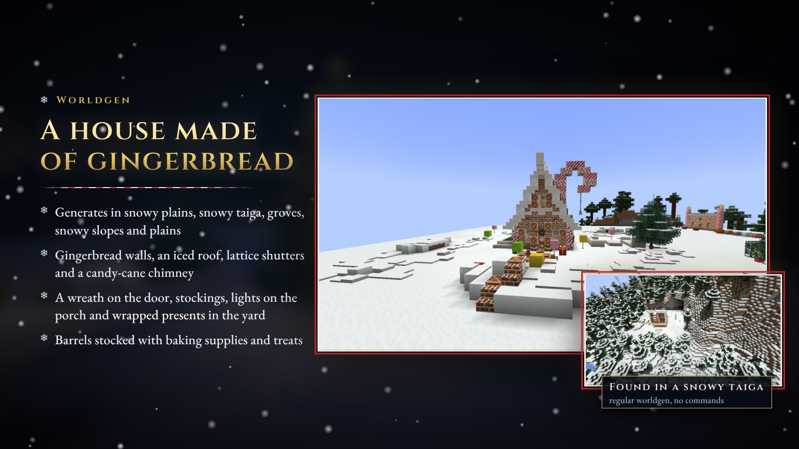

- Generates in snowy plains, snowy taiga, groves, snowy slopes and plains.
- Built from the mod's own blocks: gingerbread brick walls, an iced roof, gingerbread lattice shutters, a gingerbread door and a candy-cane chimney.
- A wreath on the door, stockings, lights on the porch and **two sealed presents** in the yard.
- Its barrels are stocked with baking supplies, treats and sometimes another present or an advent calendar.

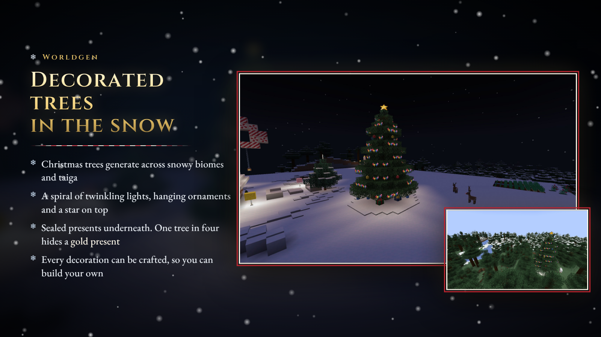

- Decorated Christmas trees generate across snowy biomes and taiga.
- A spiral of twinkling lights, hanging red, gold and blue ornaments, and a star on top.
- Four sealed presents underneath. One tree in four hides a **gold present** with rare loot.

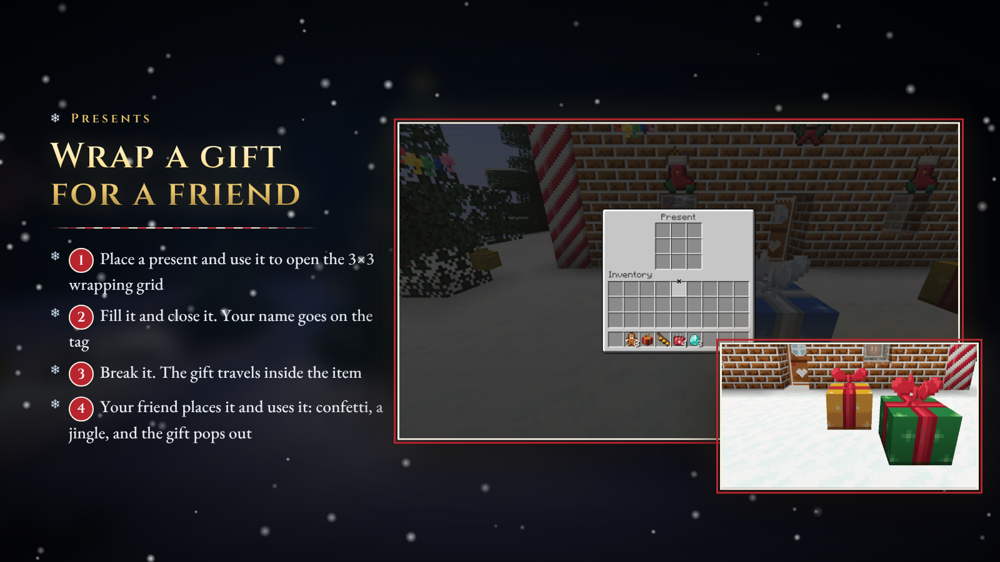

1. Craft a present: paper, string and a dye (a gold nugget for the gold one). Red, green, blue and gold.
2. Place it and use it. A 3×3 wrapping grid opens. Put the gift inside and close it: your name goes on the tag.
3. Break it. The present keeps its gift, so you can carry it, mail it or leave it under someone's tree.
4. Your friend places it and uses it: confetti, a jingle, *"A present from …!"*, and the gift pops out.

Sneak and use a wrapped present to peek inside and change the gift. Presents found in the world are sealed with loot until someone opens them.

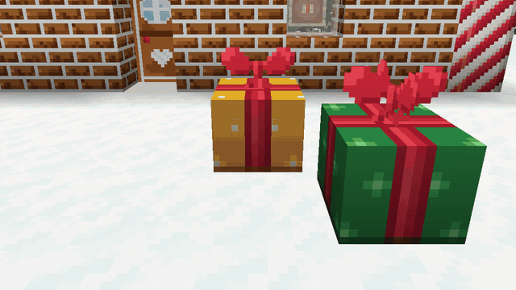

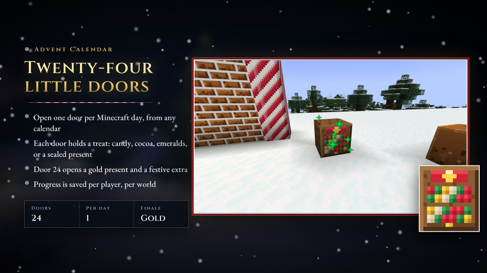

- Craft an **Advent Calendar** from spruce planks and a gingerbread cookie, and place it on a wall or a table.
- Each player can open **one door per Minecraft day**, from any calendar in the world.
- Every door holds a treat: candy canes, cookies, hot cocoa, emeralds, fireworks or a sealed present.
- **Door 24** opens a gold present plus a music disc, a Santa hat or a festive sweater. Then a new season starts the next day.

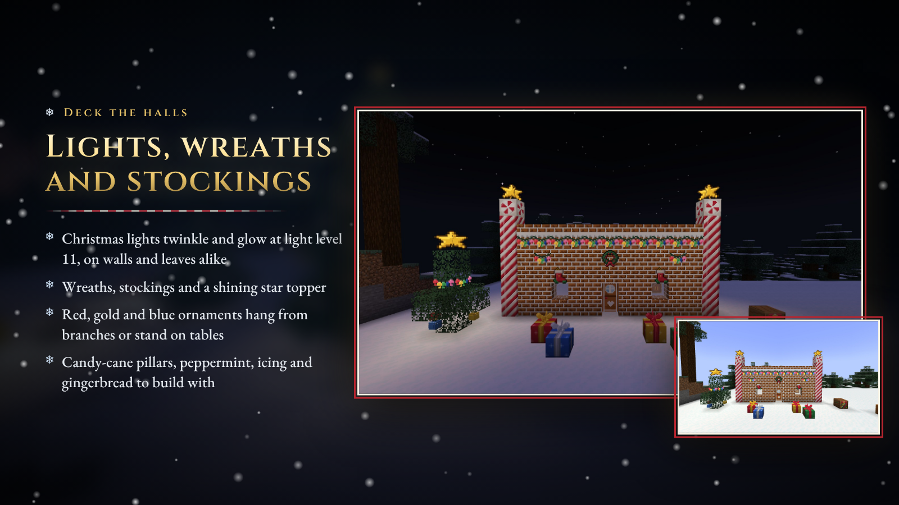

| Decoration | How it hangs |
| --- | --- |
| **Christmas Lights** | On any wall or on leaves. Animated twinkle, light level 11 |
| **Wreath**, **Stocking** | On any wall or on leaves |
| **Star Topper** | On top of any block or leaves. Light level 15, sparkles |
| **Red, Gold and Blue Ornaments** | Hanging from a block or leaves, or standing on a block |

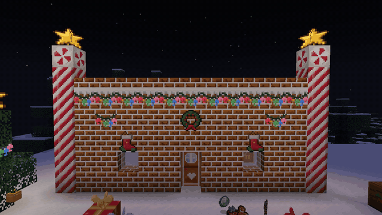

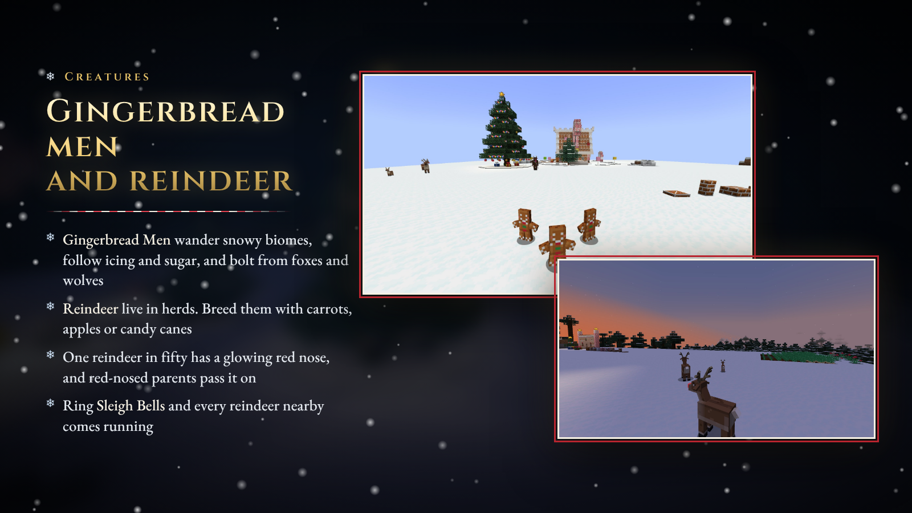

- **Gingerbread Men** run around snowy biomes. They follow anyone holding icing or sugar, flee foxes and wolves, and crumble into gingerbread.
- **Reindeer** live in herds in snowy plains, snowy taiga, groves and taiga. Breed them with carrots, apples or candy canes.
- **One reindeer in fifty has a glowing red nose.** Calves of a red-nosed parent have a one in four chance. Name any reindeer *Rudolph* and its nose lights up too.
- Ring **Sleigh Bells** and every reindeer within 24 blocks comes running, with a burst of speed for you and them.

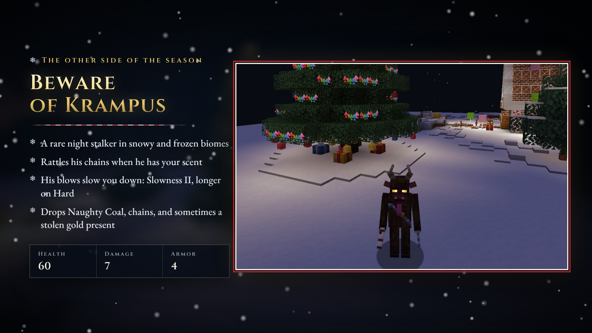

- A rare night stalker in snowy and frozen biomes: 60 health, 7 damage, 4 armor.
- He rattles his chains when he has your scent, and each blow slows you (Slowness II, longer on Hard).
- Drops **Naughty Coal** (burns for 16 items), chains, and when killed by a player, sometimes a **stolen gold present**.

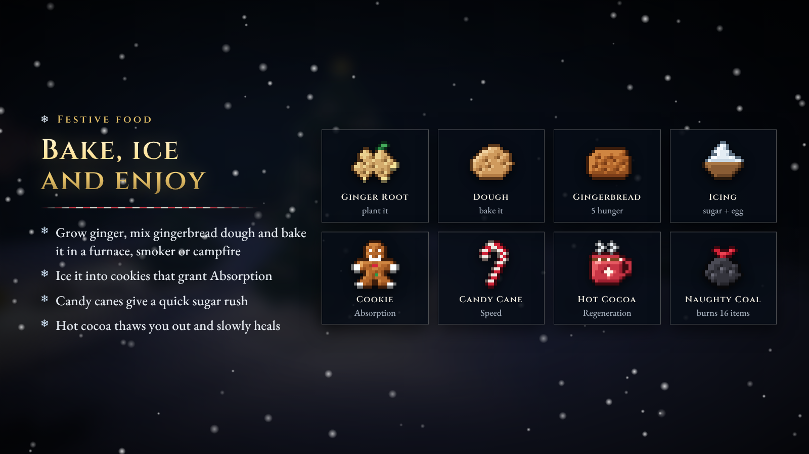

| Item | Recipe | Effect |
| --- | --- | --- |
| **Gingerbread Dough** | 2 wheat, ginger root, sugar (makes 2) | |
| **Gingerbread** | Smelt, smoke or campfire-cook the dough | 5 hunger |
| **Icing** | 2 sugar, egg (makes 3) | |
| **Gingerbread Cookie** | Gingerbread and icing (makes 2) | 6 hunger, Absorption for 20 s |
| **Candy Cane** | 2 sugar, red dye (makes 2) | Speed for 10 s, eat any time |
| **Hot Cocoa** | Cocoa beans, milk, sugar, bowl | Thaws you, Regeneration for 6 s |

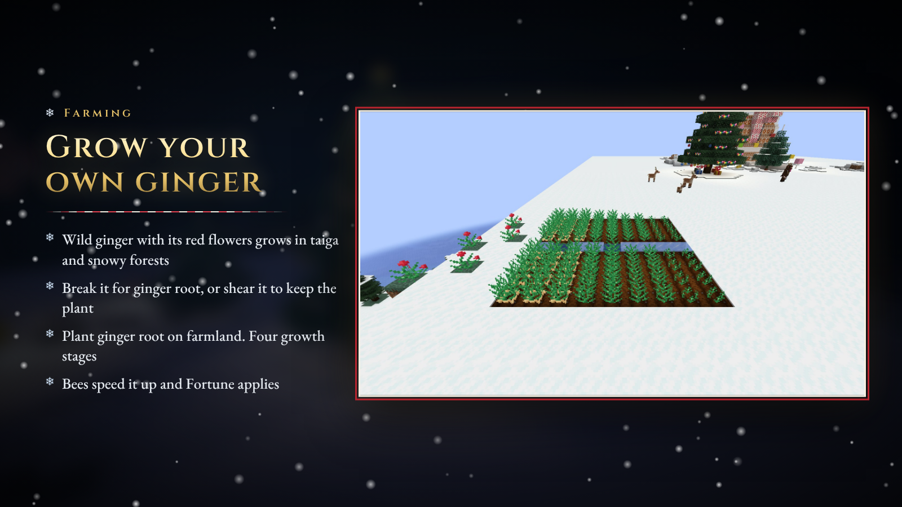

- **Wild ginger** with its red flower spikes grows in taiga and snowy forests. Break it for ginger root, or shear it to keep the plant.
- Plant ginger root on farmland. It grows in four stages, bees speed it up, and Fortune applies.

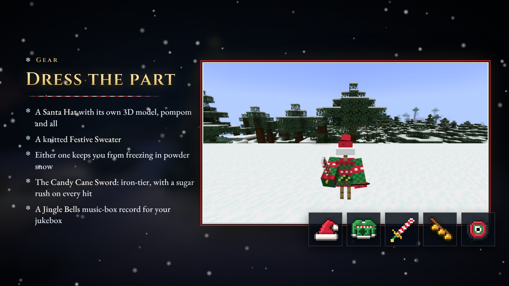

- **Santa Hat**, with its own 3D model, and the knitted **Festive Sweater**. Leather-grade protection, repaired with wool, and wearing either one keeps you from freezing in powder snow.
- **Candy Cane Sword**: an iron-tier blade that gives you a short sugar rush (Speed) on every hit.
- **Music Disc: Jingle Bells**, an original music-box arrangement (64 s). Also a creeper drop.

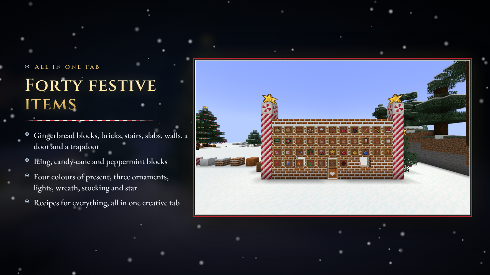

- **Building blocks:** Gingerbread Block, Gingerbread Bricks with stairs, slab and wall, Frosted Gingerbread Bricks, Gingerbread Door and Trapdoor, Block of Icing, Candy Cane Block and Peppermint Block. Stonecutter recipes included.
- **Everything is craftable** and sits in one **Christmas Ginger House** creative tab with spawn eggs.
- **Eleven advancements**, from *Sweet Tooth* to *'Twas the Night Before Christmas* and *Naughty List*.
- **Original sounds** for sleigh bells, unwrapping, the advent calendar, gingerbread men and Krampus.
- **Data-driven:** spawns, wild ginger and both structures use biome tags; all loot is in loot tables. Override them with a data pack.

| Minecraft | Loaders | Java |
| --- | --- | --- |
| 1.20.1 | Fabric (with Fabric API), Forge 47+ | 17 |
| 1.21.1 | Fabric (with Fabric API), NeoForge | 21 |
| 26.1.2 | Fabric (with Fabric API), NeoForge | 25 |
| 26.2 | Fabric (with Fabric API), NeoForge | 25 |

- Every version has the same content.
- Install on both the server and the clients.

**Is it just for December?**
No. Everything is available all year.

**Can I find the house and trees with commands?**
`/locate structure christmas_ginger_house:christmas_ginger_house` and `/locate structure christmas_ginger_house:christmas_tree`.

**Can I stop Krampus from spawning?**
Empty the biome tag `christmas_ginger_house:spawns_krampus` with a data pack. The same works for `spawns_reindeer`, `spawns_gingerbread_men` and `has_wild_ginger`.

**Will a present lose its gift if I break it?**
No. Breaking a present keeps the gift inside the item, in Survival and Creative.

**Can I use this in my modpack?**
Yes. It is licensed under Apache-2.0.

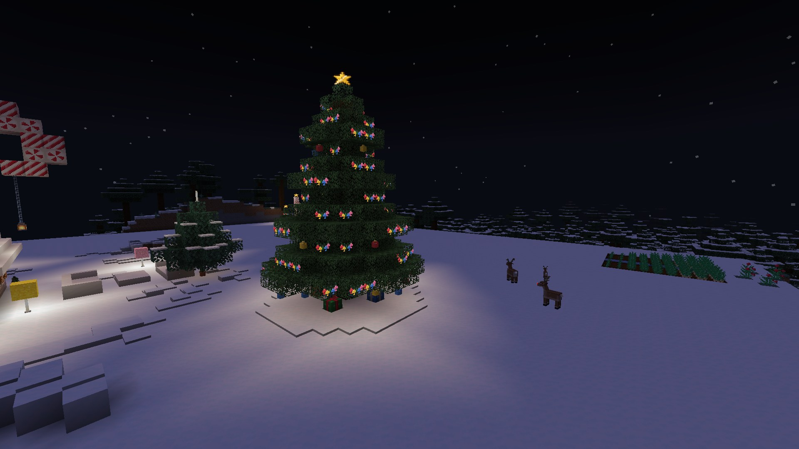

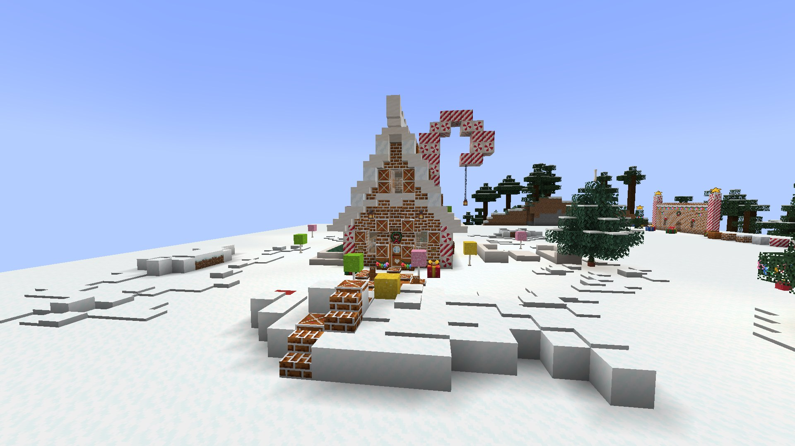

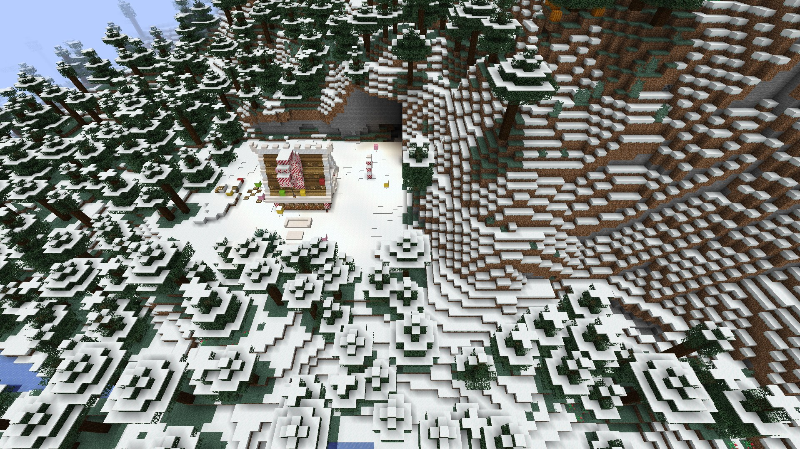

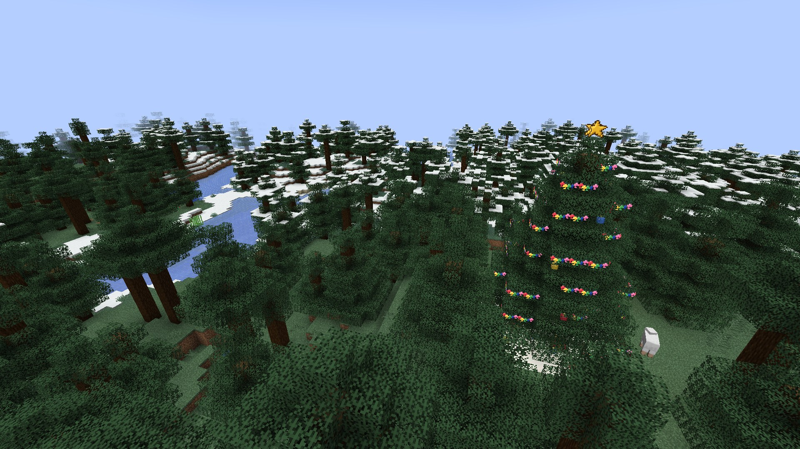

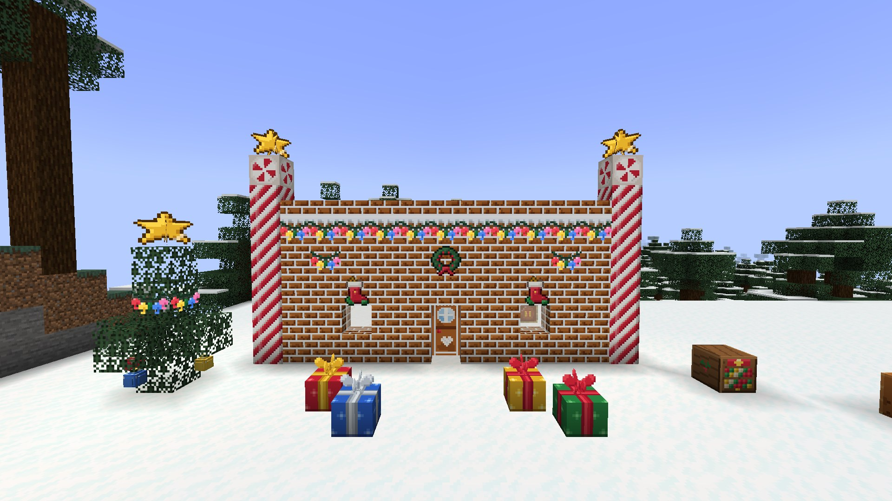

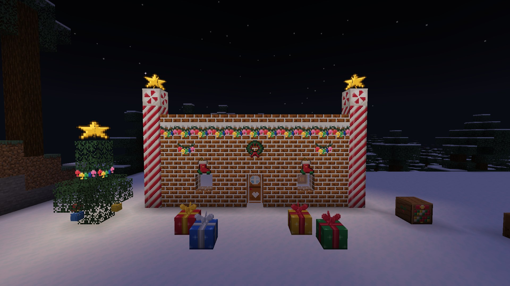

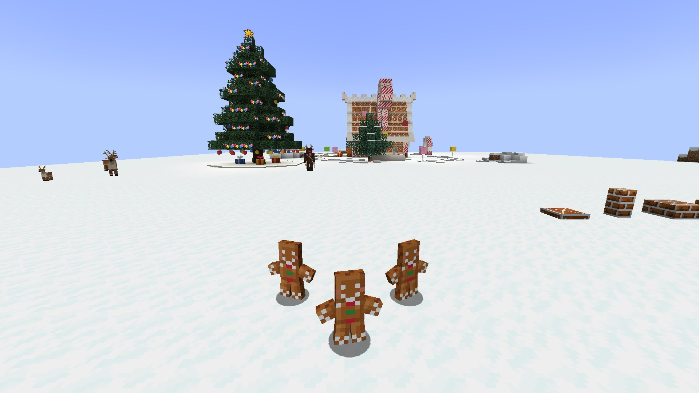

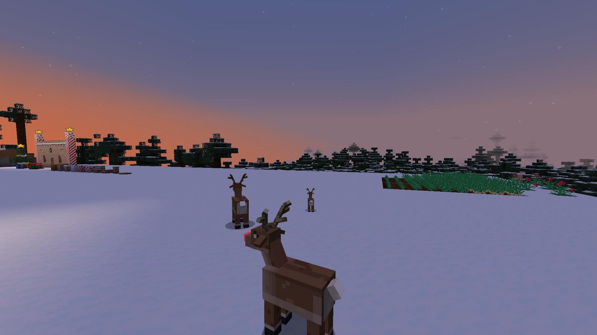

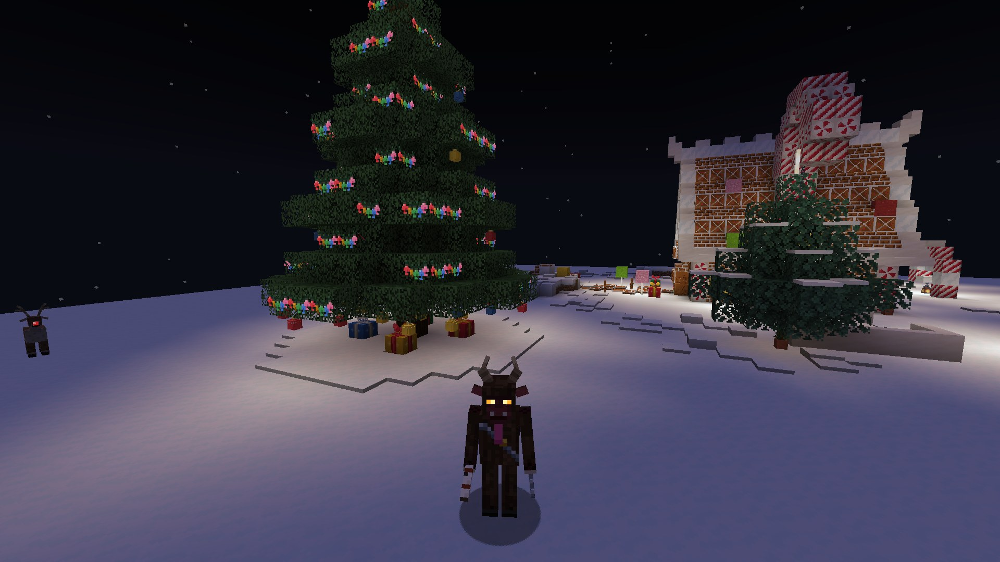

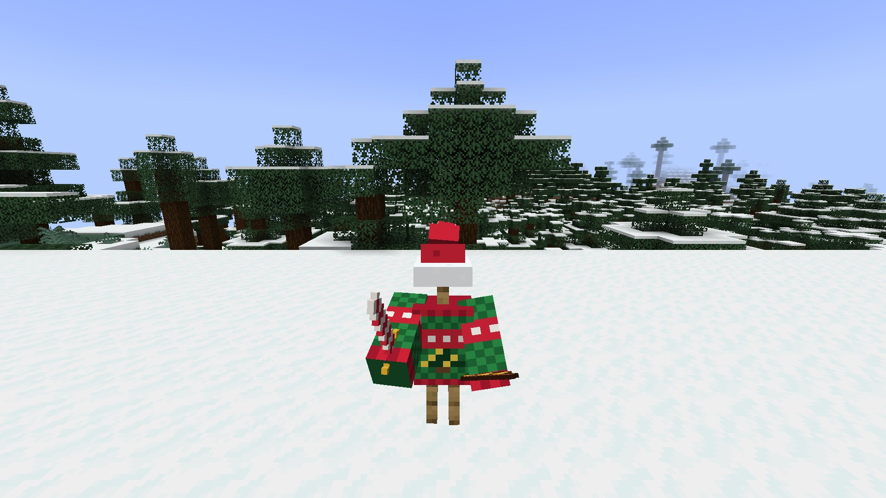

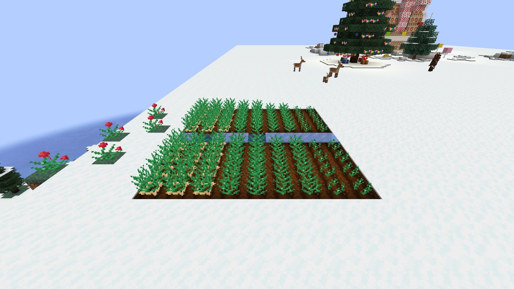

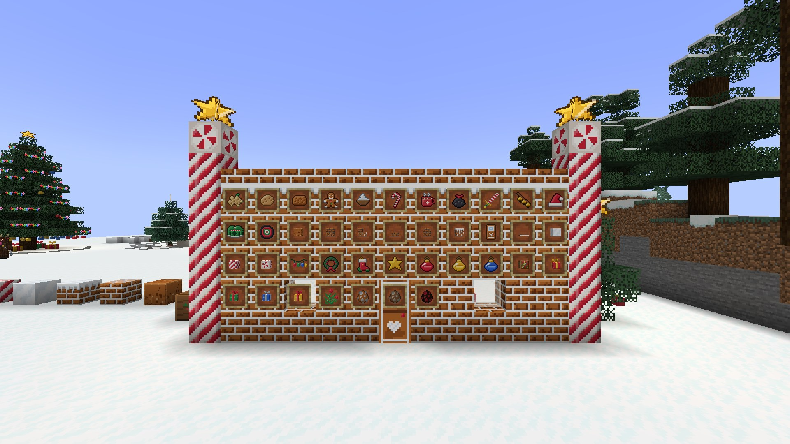

---

Christmas Ginger House is licensed under Apache-2.0. The Cinzel and EB Garamond fonts used in this artwork are licensed under the SIL Open Font License 1.1. "Jingle Bells" (J. L. Pierpont, 1857) is in the public domain; the music-box arrangement and every other sound and texture were made for this mod.

---

> **Featured in [Remnants: Ashen Legacy](https://www.curseforge.com/minecraft/modpacks/remnants-ashen-legacy)**, NightBeam's story-driven soulslike RPG modpack.

---

### More from NightBeam Studio

- **[Remnants: Ashen Legacy](https://www.curseforge.com/minecraft/modpacks/remnants-ashen-legacy)**: the story-driven soulslike RPG modpack built on NightBeam's mods
- **[Premium server plugins](https://nightbeam.dev/store)**: anti-cheat, ranked PvP, SMP setups and more on BuiltByBit
- **[NightBeam Pro](https://nightbeam.dev/memberships)**: the model library and NightBeam Forge credits, from $5 a month
- **[Discord](https://discord.gg/TJc3CxR4jK)**: support, bug reports, suggestions and early looks
- **[Support NightBeam](https://nightbeam.dev/support)**: help keep every mod free

**Follow:** [YouTube](https://www.youtube.com/@nightbeamstudio) · [Instagram](https://www.instagram.com/nightbeamstudio/) · [X](https://x.com/NightBeamLLC) · [Facebook](https://www.facebook.com/profile.php?id=61574823331471)
